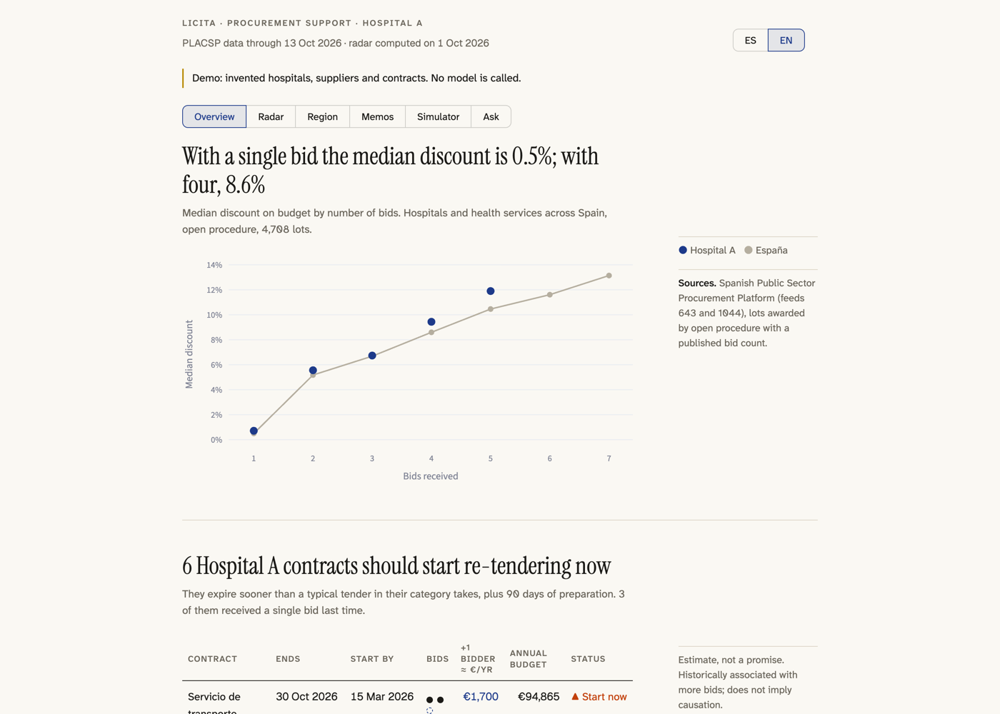
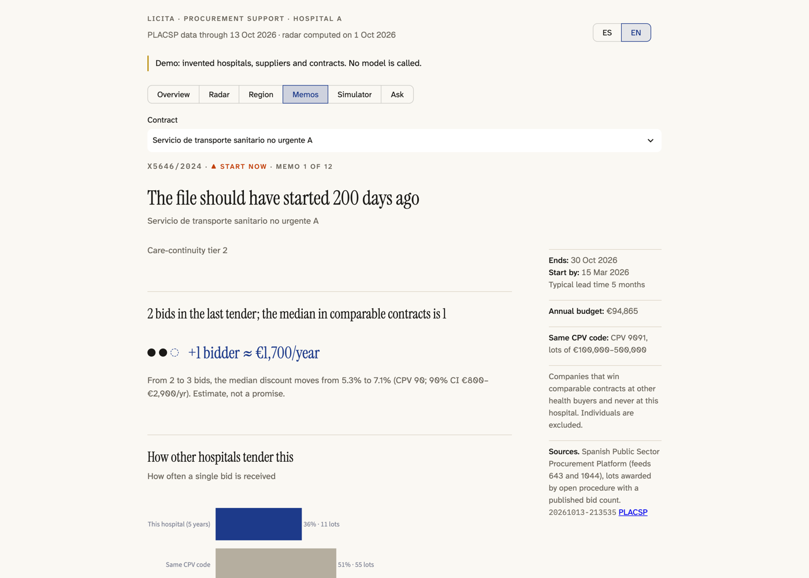
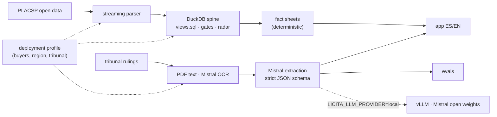

# Licita

**Competition evidence for Spanish public-hospital procurement, built on open data and Mistral AI.**

[](https://github.com/Digvijay-classai/licita/actions/workflows/ci.yml)


Across Spanish public health buyers, an open-procedure lot that receives **one bid is awarded at a median
discount of 0.0 %**. With two bids the median is 6.9 %, with four it is **13.8 %** (140,952 lots from the
2017–2026 PLACSP archives). Most of that competition is decided *before* a tender is published, by
drafting choices.

Licita gives the hospital's procurement team the evidence at that moment. For each contract that must be
re-tendered soon it produces a memo, in Spanish or English: **when** to start, **how comparable hospitals**
tender the same thing, **what one more bidder is worth** in € per year with a confidence interval,
**which suppliers** to invite, and **which clauses** resemble ones a procurement tribunal has annulled,
quoted verbatim from rulings that Mistral models read and structure.





<sub>Screenshots from `make demo`: invented hospitals, suppliers and contracts.</sub>

## Try it in one minute (no key, no download)

```bash
make setup     # uv sync + git hooks
make demo      # synthetic hospitals and contracts through the real pipeline, then the app
```

`make demo` generates ~6,000 invented lots, runs the production spine build, radar and fact sheets, and
opens the app with a demo banner. Or `docker compose up app` and open http://localhost:8501.

## Run it on real data with Mistral

```bash
export MISTRAL_API_KEY=...                 # the only credential; see docs/deploy/SECURITY.md
cp profiles/example.toml profiles/mine.toml   # buyers, region filters, tribunal URL (gitignored)
make config PROFILE=mine                    # effective provider, per-task models, paths
make smoke-mistral PROFILE=mine             # one live call: confirms key, schema and model
make backfill build PROFILE=mine            # ~10 GB of PLACSP open data -> versioned DuckDB spine
make schedule-install PROFILE=mine          # then keep it current: `licita sync` daily (ETag diff, gate, facts)
make scrape pdfs extract PROFILE=mine       # tribunal rulings -> Mistral Batch API extraction
make collect                                # resumable; bad lines never abort a collection
make app PROFILE=mine BUYER=<KEY>
```

Self-hosted instead of the API: `docker compose --profile vllm up` serves Mistral Small 3.2 open weights
on your GPU and `LICITA_LLM_PROVIDER=local` sends the same requests there. Nothing leaves the network.

## Results

| Evaluation | Status |
|---|---|
| Mistral Small / Medium / Large and self-hosted Small on a hand-labelled golden set: validity, outcome, ground precision and recall, decision per ground, verified quotes, € per 1,000 rulings, latency, all with Wilson 95 % intervals | harness and CI replay done; first live run is `make label` then `make evals` |
| Open 14B baseline (Qwen3, Kaggle T4s, same prompt and schema) | measured and rejected: 0/12 decisions per ground correct ([EVALS](docs/engineering/EVALS.md)) |

## Why it is built the way it is

| Concern | What was done |
|---|---|
| **Discovery** | Interview guide for the procurement team, premises challenged before building, 24 scope decisions recorded. The story end to end: [CASE_STUDY](docs/CASE_STUDY.md) (value case, 30/60/90 rollout). |
| **Data** | 10 GB of PLACSP CODICE/Atom archives streamed into a DuckDB spine of 452,466 lots; coverage gates fail the build if key fields drop below fixed floors. |
| **Judgement in code** | Numbers that would mislead are suppressed: insignificant bidder value, framework-derived contracts, manufacturer incumbents, likely technical exclusivity. Models never compute a figure the reader sees ([ADR 0004](docs/engineering/adr/0004-deterministic-numbers.md)). |
| **Models** | Mistral with strict JSON schema, no tools, full validation, verbatim-quote checks; Batch API at half price; OCR for scans; aliases pinned to dated model ids; the same code runs on self-hosted open weights. |
| **Evaluation** | Private golden set, labelling guide, labeller agreement, tribunal label as an independent check, intervals, dated prices ([ADR 0005](docs/engineering/adr/0005-evaluation-method.md)). |
| **Anonymity** | No buyer, region or tribunal is named in the code: they live in a gitignored deployment profile, and a hashed-denylist gate enforces it in CI ([ADR 0003](docs/engineering/adr/0003-profile-anonymisation.md)). |
| **Operations** | One `licita` CLI, errors that say problem / cause / fix, offline tests with sockets blocked, a demo that renders every page in CI, a container image built in CI, and a release workflow that signs images and attaches an SBOM. |

## Architecture



Details: [ARCHITECTURE](docs/engineering/ARCHITECTURE.md).

## Documents

| For | Read |
|---|---|
| A reviewer with 5 minutes | this page, then [CASE_STUDY](docs/CASE_STUDY.md) |
| Security, data protection, IT | [DEPLOYMENT](docs/deploy/DEPLOYMENT.md) · [SECURITY](docs/deploy/SECURITY.md) · [GOVERNANCE](docs/deploy/GOVERNANCE.md) · [RUNBOOK](docs/deploy/RUNBOOK.md) · [RESIDUAL_RISK](docs/deploy/RESIDUAL_RISK.md) |
| Engineers | [ARCHITECTURE](docs/engineering/ARCHITECTURE.md) · [DATA](docs/engineering/DATA.md) · [EVALS](docs/engineering/EVALS.md) · [ADRs](docs/engineering/adr/) · [DESIGN](docs/engineering/DESIGN.md) · [CONTRIBUTING](CONTRIBUTING.md) |

## Repository map

```
src/licita/
  profile.py   deployment profiles (buyers, region, tribunal, models)
  llm/         Mistral provider (chat, batch, OCR), local OpenAI-compatible provider, pricing
  ingest/      PLACSP download, streaming CODICE parser, resumable backfill
  spine/       metric views (views.sql), versioned build + gates, successor matching, radar,
               reason buckets, deserted-lot tracker, regional benchmark, ground truth
  export/      OCDS 1.1 release of the health slice + datasheet
  rulings/     schema + migrations, scraper, PDF text / OCR, Mistral extraction, open-model baseline
  evals/       golden-set scoring, intervals, replay, labelling sampler
  memo/        fact sheets, tender-document fetcher
  app/         Streamlit app (theme, components, pages)
  demo.py      synthetic dataset through the production pipeline
  anon.py      anonymity gate          cli.py   `licita <command>`
profiles/      example.toml (committed; real profiles are gitignored)
docs/          CASE_STUDY, deploy/, engineering/ (incl. adr/)
```

## Data sources and status

Plataforma de Contratación del Sector Público (PLACSP) open-data feeds 643 and 1044, and the published
resolutions of a regional administrative tribunal for contract appeals (set per profile). All public.
Independent, non-commercial research; decision support, not legal advice. Clause linter, cited chat and
the memo narrative are next ([TODOS](TODOS.md)).

Author: Digvijay Singh · Licence: [Apache-2.0](LICENSE)
