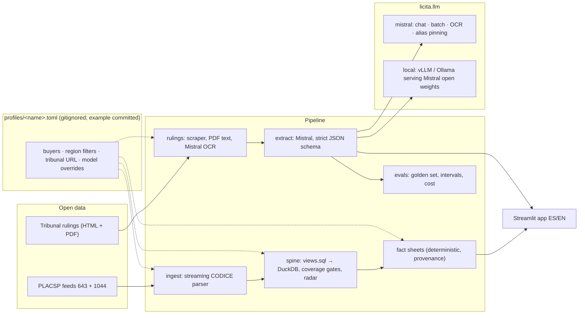

# Architecture

Licita turns two public sources, national procurement records and a regional tribunal's rulings, into a
memo a hospital procurement team can act on before a tender is drafted. Numbers are computed
deterministically; Mistral models read and structure legal text. Nothing that ties a build to a region or
a buyer lives in the code: it lives in a deployment profile.

## Components



| Stage | Module | What it does |
|---|---|---|
| Profile | `profile.py` | Loads `LICITA_PROFILE` lazily (a missing profile never breaks imports). Buyers, region NUTS prefix, parse-time parent-chain filter, central purchasing bodies, regional health terms, title stopwords, tribunal URL, per-task models. |
| Ingest | `ingest/` | Downloads yearly and monthly PLACSP archives (sizes probed, `.part` files, zip test, retries). An `lxml.iterparse` parser streams entries into Parquet (atomic writes), keeping health buyers and the profile region's buyers. `sync.py` is the scheduled connector: ETag change detection, fetch only what changed, rebuild behind the gate, log. |
| Spine | `spine/views.sql`, `spine/build.py`, `spine/buyers.py` | One SQL file defines every metric. The build loads each snapshot once, resolves buyers to one key, unions paged awards, materialises the views into a new DuckDB file, checks coverage floors, runs the smoke test and the quality gate (`spine/dq.py`), records a schema version and `data_through`, swaps a symlink atomically and keeps three spines. |
| Radar | `spine/successors.py`, `spine/radar.py` | Per contract: is there already a successor (trigram similarity on boilerplate-stripped titles, CPV multiplier, time window)? If not, when must re-tendering start (end date − p80 lead time − 90 days)? The team's ground truth (`spine/truth.py`, `data/truth/*.csv`) overrides the match and scores it. |
| Reasons | `spine/reasons.py` | Every single-bid lot gets a bucket (structural / earlier decision / addressable), a confidence and the signals that fired (brand and manufacturer, peer exclusivity, extension, framework, compatibility cues, thin market, short deadline), plus the lever for the next tender. Rule-based and arguable line by line; the 50-lot labelling session is its evaluation. |
| Deserted | `spine/deserted.py` | Every deserted or withdrawn lot with its budget, whether and when the buyer republished it, the outcome, and what the national market for that CPV looks like. |
| Benchmark | `spine/benchmark.py`, `spine/cpv_tiers.csv`, `spine/regions.py` | One row per health buyer: timeliness (files on time, late, past term with no successor), extension and negotiated shares, deserted rate, single bid actual vs expected with a Wilson interval and shrinkage, value at risk weighted by care-continuity tier, a coverage score and bands within the region. No rank column by design. |
| Export | `export/ocds.py`, `export/datasheet.py` | OCDS 1.1 compiled releases (JSONL, gzip) of the health slice with a meta sidecar and a datasheet; natural persons excluded. |
| Rulings | `rulings/` | `db.py` owns the schema (source-qualified ids, versioned migrations). Scraper (resumable jobs), PDF text, optional Mistral OCR for scans, outcome classifier. |
| Extraction | `rulings/extract.py` | Mistral Batch API (or concurrent sync calls for a local server). Strict JSON schema, no tools, full validation, quote verification, provenance on every row. |
| Evaluation | `evals/` | Golden-set scoring with Wilson intervals, cost from a dated price table, latency, labeller agreement, offline replay for CI. |
| Fact sheets | `memo/facts.py` | Peers, the buyer's history, value of one more bidder with a bootstrap CI, invite list, guardrail flags. JSON with provenance. |
| App | `app/` | Streamlit, one build per buyer (`LICITA_PROFILE` + `LICITA_BUYER`). Memos lead with continuity (the date, the reason bucket, the tier) before competition; a Region page shows the benchmark bands and centralisation candidates. Pure HTML builders are unit-tested. Refuses a missing or outdated spine with the fixing command. |
| Demo | `demo.py` | Synthetic dataset run through the production build, radar and fact sheets. |
| CLI | `cli.py` | `licita <command>` for every job; `licita config` shows the effective setup. |

## Data flow

```
PLACSP archives ──► parquet ──► spine.duckdb ──► radar ──► fact sheets ──────────────► app
      ▲ licita sync (daily: ETag diff → fetch → build behind the dq gate → facts)
Tribunal HTML/PDF ──► rulings.duckdb ──► (OCR) ──► Mistral extraction ──► grounds ──► evals / linter
```

Two stores, both local and git-ignored: `spines/spine_<run>.duckdb` (rebuilt, versioned) and
`data/state/rulings.duckdb` (append-only jobs and results, every row keyed by the dated model id).

## Guardrails in the numbers

The most important design decisions are about what *not* to show. Each one is enforced in code and
covered by a test.

| Situation | What Licita does | Why |
|---|---|---|
| The +1 bidder step's 90 % CI includes zero | No € figure; the memo says the association is not significant | A number with a coin-flip sign is worse than none |
| Single bid here **and** in ≥ 80 % of comparable contracts | Headline says "likely technical exclusivity"; the € figure becomes a conditional sentence | Promising savings on an exclusive OEM service would destroy trust in the first meeting |
| Contract derived from a framework agreement | No +1 bidder estimate, no empty chair, sorted last | The hospital cannot reopen competition; it was set at framework level |
| Incumbent is the equipment manufacturer | Flag: the question becomes third-party servicing | Different action from "invite more bidders" |
| Generic CPV code (e.g. MRI maintenance filed as 50000000) | Topic peers from the title's rarest meaningful words, with the scope shown and small samples labelled | Code-only peers pooled MRI with lifts and security guards |
| Lots with 8+ bids | Excluded from the curve | Mostly unit-price or framework artefacts (62.6 % median "discount") |
| Natural persons among past winners | Never in invite lists | Individuals' IDs are personal data even when published |
| Any data string in the UI | HTML-escaped | PLACSP fields are untrusted input |

## Model use

| Task | Default model (Mistral) | Mode | Controls |
|---|---|---|---|
| Ruling extraction | `mistral-small-latest`, pinned to its dated id per run | Batch API (50% price) or sync | Strict `json_schema`, `<ruling_text>` envelope declared untrusted, no tools, full schema validation, every quote fuzzy-matched (≥ 90) against the exact text sent |
| Scanned rulings | `mistral-ocr-latest` | Sync, bytes inline | `text_source` recorded; quotes verified against the OCR text |
| Clause linting (next) | `mistral-medium-latest` | Sync | Same envelope, citations to extracted doctrine only |
| Memo narrative (next) | `mistral-medium-latest` | Precomputed, both languages | May only cite numbers present in the fact sheet |
| Cited chat (next) | `mistral-large-latest` | Parameterised tools over the spine | No free-form SQL; red-team suite |

Self-hosted: any task except OCR can run on `mistralai/Mistral-Small-3.2-24B-Instruct-2506` (Apache-2.0)
behind vLLM; see [DEPLOYMENT](../deploy/DEPLOYMENT.md). Per-task overrides: env `LICITA_MODEL_<TASK>` >
profile `[models]` > defaults.

## Failure handling

| Path | Failure | Behaviour |
|---|---|---|
| Profile | missing / invalid | `ProfileError` with problem, cause, fix; app shows it instead of a traceback |
| Mistral | 401/403 | stop: "rotate the key" |
| Mistral | 429, 5xx, transport | exponential backoff with jitter, honours `Retry-After`; attempts stored per row |
| Batch | invalid JSON / truncated / error line / unknown or duplicate id | stored as `invalid_json`, `length`, `errored`, or counted and skipped; collection never aborts |
| Batch | job ends with unanswered requests | stored as `missing` and re-queued; uploaded files deleted after collection |
| Local server | unreachable | error names the base URL and a `curl …/models` check |
| Evals | empty golden set / n below minimum | refuses to report / hides P/R |
| Spine | missing or older schema | refuses with "make build" / "make demo" |
